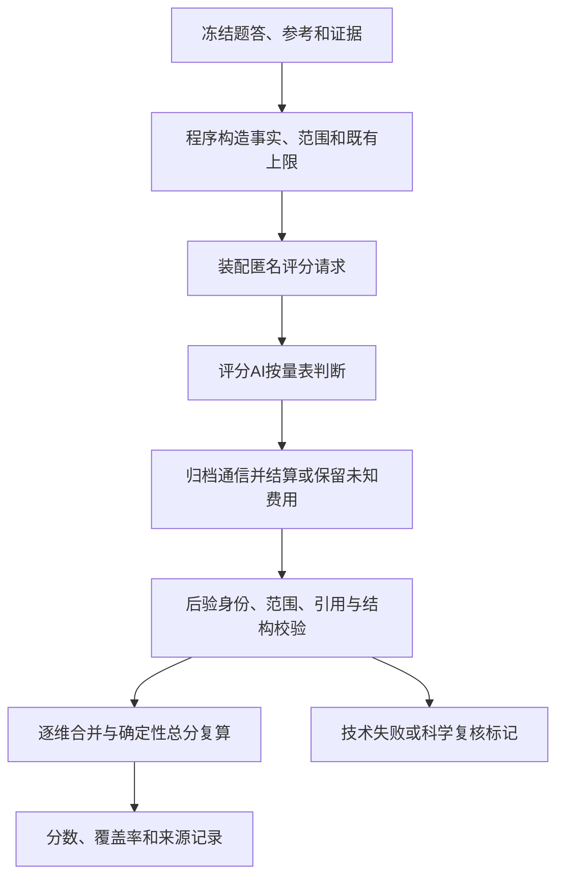

# 实际评分流程：程序事实、AI判断与后验校验

## 1. 输入与前置程序处理

评分对象是冻结的题面和原答。程序使用任务scope、方向／图连接、逐步对齐、accepted酶集合、引用目录与证据快照构造事实合同，再给各维可选范围及已成立的限制。

实际实现：[build_items.py](../code/runtime/v05_release/build_items.py)的`derive_contract`、`render_slot`；[rules_03a.py](../code/runtime/v05_release/rules_03a.py)的`classify`、`decide`、`user_key_cap`；[registry_03d.py](../code/runtime/v05_release/registry_03d.py)的主链／KEY登记门；[proofs_03a_r1.py](../code/runtime/v05_release/proofs_03a_r1.py)的事实证明绑定。

这些前置事实不等于AI已经打分，也不等于自动匹配UNKNOWN必然是科学不可判。完整酶模块未交付可确定MISSING=1；已确认KEY失败提供≤4上限；未知目标、证据与表示需按固定量表判断，不从未知比例猜整数。

## 2. 装配请求并由裁判判断

输入包含原题、原答、对应参考／accepted、事实／范围、引用目录和同一评分表。没有旧分数、旧排名作为答案提示。已认可主链来自现成目录，不把全图所有分支联合当缺步分母。最后补证保留独立版本，评价侧新证据不回填为被测模型原有来源。

完整协议：[v05_request_builder.py](../code/runtime/v05_release/v05_request_builder.py)、[s6_run_node.py](../code/executed_workflows/full_run/s6_run_node.py)。最后补评与主链接线：[ne_repair.py](../code/executed_workflows/ne_repair/ne_repair.py)、[scoped_ne_repair.py](../code/executed_workflows/ne_repair/scoped_ne_repair.py)。定向补证：[score_with_evidence.py](../code/executed_workflows/evidence_supplement/score_with_evidence.py)。

AI依据同一量表对请求维度选择整数或说明真实不可判。程序上限不是固定分；≤4不能自动替换为4。评分模型为`deepseek-v4.1-flash-1017`。完整七维和局部补评使用同一科学量表，但输出协议可不同，不能混用身份或把旧结果当成新结果。

## 3. 传输、归档和结算

全量runner顺序为：运行身份检查→缓存重验／checkpoint去重→槽尝试门→费用预留→真实请求→原通信归档→按usage优先结算／保留unknown→解析与验证→canonical／commit。

见[run_lib.py](../code/runtime/v05_release/run_lib.py)、[f2r12_transport.py](../code/runtime/f2/f2r12_transport.py)、[f2r12_cache_checkpoint.py](../code/runtime/f2/f2r12_cache_checkpoint.py)、[f2r12_budget_ledger.py](../code/runtime/f2/f2r12_budget_ledger.py)。因此校验拒绝不等于没花钱；断流未知不能洗成免费或从未发过。

## 4. 返回后的确定性验证与复算

AI返回后再次核身份、请求维度、严格整数、范围、KEY上限、引用白名单及必要论证。完整协议还核逐步矩阵与输入事实一致性。见[release_validation.py](../code/runtime/v05_release/release_validation.py)、[r2p_pipeline.py](../code/runtime/pipeline/r2p_pipeline.py)及[v05_rating_pipeline_r3.py](../code/runtime/pipeline/v05_rating_pipeline_r3.py)。

轻量补评的已执行`validate`和格式恢复函数导出到[validation.py](../code/likert_eval/validation.py)，原函数来源在manifest中逐项标明；可运行入口通过[pipeline.py](../code/likert_eval/pipeline.py)调用。它检查可判范围与返回一致性，不额外调用模型复核自己，也不以格式问题篡改科学理由。

最终总分只用[f2r12_common.py](../code/runtime/f2/f2r12_common.py)的`totals_contract`：

```text
总分 = 1.5D1 + 2.5D2 + D3a + D3b + 1.5D4 + 1.5D5 + D6
科学子分 = (25D2 + 10D3a + 10D3b + 15D4) / 60
```

MISSING=1保留原权重；NE/NA不填0、不重新归一化，整份总分标NOT_COMPARABLE。局部补评只替换对应旧NE，其余维度逐字段复用并留来源。

## 5. 哪些顺序可以由代码支持



准确说法是“前置程序约束＋AI量表判断＋后验程序验证与复算”。不能说所有确定性检查都在AI之前完成，也不能仅凭代码存在宣称系统已经实现真人复核。此图描述评价流程，不表示depending在线生成主图已有这些节点。
