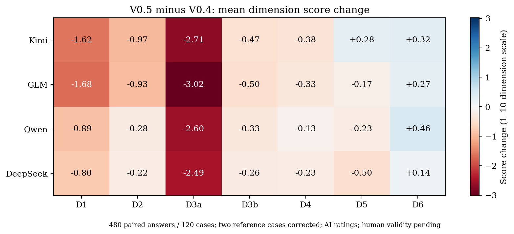
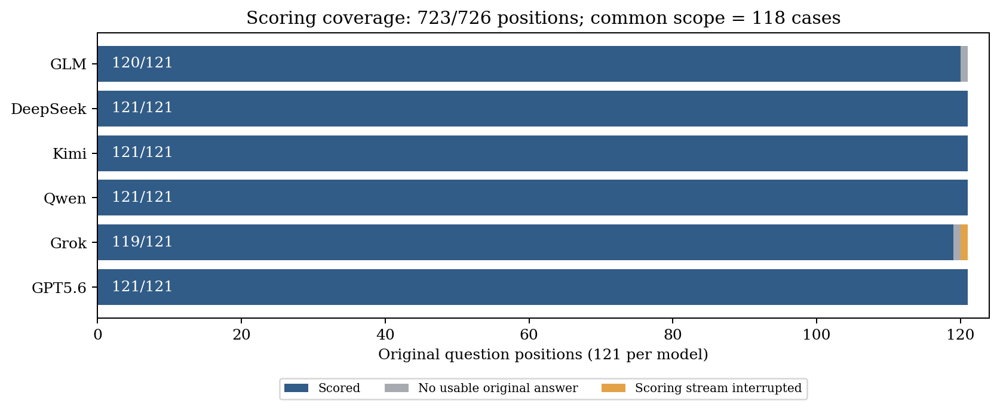

# 给黄老师：Likert V0.5结果、版本变化与六模型同题比较

2026-11-15。本报告落实11月5日V0.5修订要求及11月11日国外模型对比要求。主表为实际结果，实际人评和未完成项另列；不把数值齐全称为科学验证全部闭环。

## 1. 当前完成情况

- 121题×6模型=726个位置；723份已有七维评分和完整总分。
- 723×7=5061维：SCORED=4823、MISSING=238、NE=0。MISSING表示原答案缺少内容，按既有规则计1分，并非评分API失败。
- 六模型共同完整评分118题×6=708份；共同题集排除023、087、145。
- 原四模型B120全部480份已有V0.5评分，3360维可与V0.4同答案配对。答案SHA、恢复来源、每维原理由与评分身份可追溯。
- 剩余3位：GLM023、Grok087没有可评分原正文；Grok145一次评分请求中断，未知费用保留。位置保留，不填0、不捏造Likert分数。

## 2. 对照11月5日方法要求

**指定路线偏离程序化判定。** 已有实际有向路线检查、任务/主链范围装配与返回后验证。006维持冻结四步、披露路线定位不足并保留边界复核；016只要求至p-cumate前三步，下游作背景；020/49题保留同物种代表参照，温度测量语义和底物测试类型分别处理。规则和实际实现见[评分代码](https://github.com/bgruiiii/EnzymeCAGE-Teacher-Deliverables/tree/5867a2e403bcc8a4ca3720fb15ba3a877695c998/2026-11-14_Likert_V05_Scoring_Code)。

**目标反应＋多个可接受酶集合。** D3a评价目标反应上的功能/酶支持，错误路线内部酶自洽不能回填目标信用；多个同工酶、通配EC、缺少显式EC、未核及已核错误分别处理。参考EC/功能匹配不等于特定蛋白已经实验催化成功。

**证据状态和高档门。** 已支持、候选、待核、已核矛盾、缺失按各自规则处理；关键催化支持不足不得进9–10，局部待核不自动整维NE。程序范围、科学判据、格式兼容和后续评价侧补证分别留痕。

**痛点校准。** 实际32份AI评分流程校准覆盖001/002/006/007/018/020/024/041。它不是两位生物专家独立评分；人类独立校准/外部效度无完成依据，仍PENDING。此项不能因代码测试或AI结果完整而宣布完成。

## 3. V0.4→V0.5逐模型、逐题、逐维变化

| 模型 | V0.4原120题均分 | V0.5修正后120题均分 | 同答案总变化 | 基础参考不变118题的变化 |
| --- | ---: | ---: | ---: | ---: |
| GLM | 63.39 | 54.52 | -8.87 | -8.94 |
| DeepSeek | 52.12 | 46.68 | -5.44 | -5.33 |
| Kimi | 65.55 | 57.70 | -7.85 | -7.86 |
| Qwen | 52.84 | 47.79 | -5.05 | -4.97 |

3360个配对维度中，1531下降、556上升、1273不变。每维分差与原权重贡献均可精确计算，七维贡献之和等于总分差。两版总分顺序在该四模型视图中均为Kimi、GLM、Qwen、DeepSeek。

**分清参考变化与评分变化。** 原118题、3304维的9类基础Gold逐表一致（1062项核对）；060/094另56维采用经用户明确决定的参考修正。060补齐末步为四步；094从原题雄酮起点到雄烯二酮为两步，睾酮入口仅作背景。决定者是用户，不代称师姐或黄老师本人签署。原题、原答及旧参考保留。见[两题说明](methods/REFERENCE_CORRECTIONS_060_094.md)。

另有17个原118题维度引用独立冻结的评价侧补证、7个历史维度记录了既有程序封顶。补证不是模型原先交付的来源，程序采用分与原裁判分分别列出。实际Prompt/执行修复、参考/证据处理和裁判裁量并存，不能将所有分差全归因于量表。

逐行给旧/新分、原理由、引用、规则及背景多标签。一次新旧重评不能识别每条规则各自造成多少分；没有编造规则独立因果贡献。原三视图（V0.4原120、V0.4同118、V0.5同118）、完整120视图、原生/恢复与复审敏感性均保留。

图中为同答案描述性均值差，包含两题参考纠正；不代表人类效度、显著性或单条规则的因果效应。

## 4. 六模型共同118题

| 模型 | 全题域已评分/121 | 共同118题Likert均分 | 同答案程序五层分均值 |
| --- | ---: | ---: | ---: |
| GLM | 120/121 | 54.70 | 15.34 |
| DeepSeek | 121/121 | 46.84 | 12.76 |
| GPT5.6 | 121/121 | 37.87 | 10.07 |
| Grok | 119/121 | 56.16 | 20.73 |
| Kimi | 121/121 | 57.91 | 18.07 |
| Qwen | 121/121 | 48.11 | 12.28 |

程序与Likert不是同一量尺，程序分不是“科学正确率百分比”。两列用同一118题及同一选定答案。旧四模型B480恢复视图与原A121首答有20处不同，本次复用已有同答案程序分对齐；060/094的12份再用字节相同的原程序按修正参考离线复算。未重新生成模型答案、未覆盖A121历史表。

分母121保留，工程失败和评分中断与质量分分开。完整726表也保留原程序工程失败按政策计零的记录，那不等于对应Likert有0分或已对失败正文作科学评分。

## 5. 网关和参数披露

| 配置 | 答卷生成网关 | exact ID | search | temperature | reasoning | 输出预算 |
| --- | --- | --- | --- | --- | --- | ---: |
| GLM | Alibaba_Bailian_Beijing_historical_binding | ZHIPU/GLM-5.3 | EXPLICIT_ENABLE_SEARCH_FALSE | 0 | NOT_SENT | 131072 |
| DeepSeek | Alibaba_Bailian_Beijing_historical_binding | deepseek-v4.1-flash | EXPLICIT_ENABLE_SEARCH_FALSE | 0 | NOT_SENT | 65536 |
| GPT5.6 | OpenCode_Go | gpt-5.6-luna | NOT_VERIFIED_GATEWAY_CONTROL | NOT_SENT | NOT_SENT | 65536 |
| Grok | OpenCode_Go | grok-4.7 | NOT_VERIFIED_GATEWAY_CONTROL | 0 | NOT_SENT | 65536 |
| Kimi | Alibaba_Bailian_Beijing_historical_binding | kimi/kimi-k3 | EXPLICIT_ENABLE_SEARCH_FALSE | 0 | NOT_SENT | 65536 |
| Qwen | Alibaba_Bailian_Beijing_historical_binding | qwen3.8-max | EXPLICIT_ENABLE_SEARCH_FALSE | 0 | NOT_SENT | 65536 |

NOT_SENT表示未发送，不等于关闭或取0。旧四显式关闭search；外模空tools及GPT的tool_choice=none不能证明网关内部搜索关闭，维持未验证可控的披露。Grok历史12笔返回输出超过请求预算的事实保留，没有改写数据。

GPT5.6采用114首答＋7份选定第二答；首答通过率114/121和回收视图121/121分开报告，失败首答不重复计数。Grok原采集119份结构有效，087/145失败状态保留；145虽有可读正文，其一次评分中断仍未补回。GPT6 Luna的35题部分结果不进入这六模型主对比。该答卷集含历史恢复/累计接收视图，不能称六模型严格同次数首答实验。

所有结果限定为“同题、各自网关条件下的表现”。没有据均分宣称显著差异、等效性、跨渠道普遍模型强弱或新版量表科学效度更高。

## 6. 人工复核、费用与复现

B480-0012（题004、Qwen）D3a范围理由仍有REVIEW_SCOPE_REQUIRED。主表保留该标记，六模型另附同删该题后的117题、四模型另附119题视图。人类独立外部效度待补，不能把32份AI流程校准写成双人专家验证。

评分裁判沿用deepseek-v4.1-flash-1017；本轮两题12份实际回包型号全部核对一致，温度0、思考开启、搜索关闭。两题12次调用新增历史单价估算3.375944元；全历史1142次、已知估算567.042456元、23条未知费用储备、0在飞。不是已核套餐实扣，未知不冒称免费。本次统计、公开整理和上传新增评分调用0。详见[费用与执行](methods/COST_AND_EXECUTION.md)。

公开表和数值可用[独立复核脚本](tools/verify_release.py)离线复算。原答案、完整Gold、原始供应商通信、私有盲映射和凭据留在本地授权源；公开包只提供评价派生表、原件SHA连接和方法。源许可与权利不因本次上传改变。

## 7. 本次交付

- [要求逐项回应](TEACHER_REQUIREMENT_DELIVERY_MATRIX.tsv)。
- [Excel总表](LIKERT_V05_TEACHER_TABLES_20261115.xlsx)、[3360维新旧对照](data/V04_V05_DIMENSION_CHANGE_3360.tsv)、[逐项原因](data/CHANGE_ATTRIBUTION_3360.tsv)。
- [按题在线阅读六模型评分与新旧理由](case_reviews/INDEX.md)，共121个题目页面。
- [726位置](data/LIKERT_V05_SCORES_726.tsv)、[723份评价正文](data/LIKERT_V05_RATINGS_723.jsonl)、[共同118题708份](data/COMMON118_SCORES_708.tsv)、[剩余3位](data/UNSCORED_POSITIONS_3.tsv)。
- [实际量表](methods/SCORING_RUBRIC_USED.txt)、[解释与局限](methods/HUMAN_REVIEW_AND_OPEN_ITEMS.md)、[复算入口](methods/REPRODUCIBILITY.md)及[评分实现](https://github.com/bgruiiii/EnzymeCAGE-Teacher-Deliverables/tree/5867a2e403bcc8a4ca3720fb15ba3a877695c998/2026-11-14_Likert_V05_Scoring_Code)。

当前可报告“原四模型B120重评与新旧对照完成、六模型723份评分，人类外部效度待补”。剩余3个位置和人工科学复核未被隐藏，不能称全部研究验证闭环。
